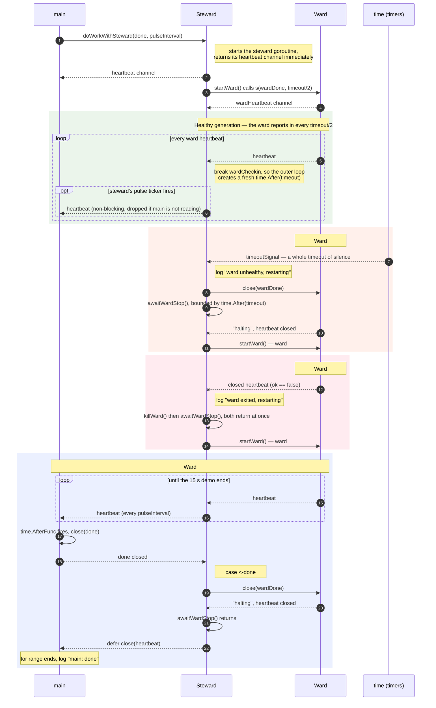

# Healing Unhealthy Goroutines — the Steward Pattern

This Go code implements a **Steward Pattern**, a concurrency design pattern used to monitor the health of a
worker goroutine (called a "ward") and automatically restart it if it becomes unresponsive or crashes.

The demo runs three wards in a row so that both ways a ward can fail — and the clean shutdown at the end — are
visible in the log.

## Contents

- [How the core mechanisms work](#how-the-core-mechanisms-work)
- [Sequence diagram](#sequence-diagram)
- [Line-by-line breakdown](#line-by-line-breakdown)
- [The demo](#the-demo)
- [Running it](#running-it)
- [What the run shows](#what-the-run-shows)
- [Why the details matter](#why-the-details-matter)

## How the core mechanisms work

| Component | Role |
| --- | --- |
| **The Steward** (`newSteward`) | The supervisor. It starts the ward goroutine and monitors it using a heartbeat channel. If the ward fails to send a heartbeat signal within a specific timeout window, the steward assumes the ward is dead or deadlocked, terminates it, and spins up a new instance. |
| **The Ward** (`doWorkFn`) | The worker goroutine executing the actual task. To prove it is still alive and healthy, it is responsible for periodically sending a blank struct (`struct{}{}`) down its heartbeat channel. |

The steward is a `startGoroutineFn` itself, so it is monitorable in exactly the same way as the thing it wraps —
stewards can be stacked.

## Sequence diagram

The demo runs three ward generations: one that deadlocks, one that crashes, and one that is healthy until shutdown.



How to read it:

- **Two independent channels.** The ward's heartbeat goes up to the steward, and the steward's pulse goes up to
  `main`. `main` never sees the ward, so the two restarts are invisible from the outside.
- **Only the ward resets the deadline.** Each heartbeat breaks the inner `wardCheckin` loop, and the outer loop
  creates a new `time.After(timeout)` on the next pass. The steward's own `pulse` case never touches it, which is
  why an unhealthy ward cannot be kept alive by the steward's good health.
- **A deadlock is detected by the clock, a crash by the channel.** Ward #1 has to burn the full `timeout` before
  `timeoutSignal` fires; ward #2's closed channel is ready immediately, so `ok == false` triggers the restart at
  once.
- **`done` unwinds the whole stack.** `main` closes `done`, the steward closes `wardDone`, waits (bounded) for the
  ward to finish, then returns — and its `defer close(heartbeat)` ends `main`'s `for range` loop.

## Line-by-line breakdown

### 1. Defining the signature

```go
type startGoroutineFn func(
	done <-chan struct{},
	pulseInterval time.Duration,
) (heartbeat <-chan struct{})
```

This defines a standard function signature for any goroutine that wants to be monitored. It must accept a
termination channel (`done`) and a time interval, and return a read-only heartbeat channel.

### 2. The monitoring loop

Inside `newSteward`, an inner loop uses a Go `select` statement to handle four concurrent events:

| Case | Meaning |
| --- | --- |
| `case <-pulse.C:` | The steward sends out its own health pulses to whoever is monitoring it (in this case, the `main` function). The send is non-blocking, so a listener that stopped reading cannot wedge the steward. |
| `case _, ok := <-wardHeartbeat:` | The ward successfully sent a sign of life. The steward resets the `timeoutSignal` timer and continues monitoring. If `ok` is `false` the ward's channel was closed, meaning the ward **returned** — it is replaced immediately instead of waiting for the timeout. |
| `case <-timeoutSignal:` | The ward went completely silent for longer than the allowed timeout. The steward logs `steward: ward unhealthy; restarting`, closes the old ward's `wardDone` channel to kill it, and calls `startWard()` to launch a fresh one. |
| `case <-done:` | The main application is shutting down. The steward kills the ward, waits for it to stop, and returns — closing its own heartbeat channel, which ends `main`'s `for range` loop. |

### 3. The demo

`main` is deliberately scripted so the pattern has something to heal. Each ward reports in every `pulseInterval`,
and the first two are given a fault:

| Ward | Behaviour | How the steward notices |
| --- | --- | --- |
| `ward #1` | **Deadlocks** after 3 heartbeats — it stops reporting in but never returns. | The 2-second timeout expires: `steward: ward unhealthy; restarting`. |
| `ward #2` | **Crashes** after 3 heartbeats — it returns, closing its heartbeat channel. | The closed channel is read at once: `steward: ward exited; restarting`. |
| `ward #3` | Healthy, until `main` shuts everything down at 15 seconds. | Nothing to do — it is killed cleanly on `done`. |

In a real program every ward is the same code; the fault is injected here only to make the pattern visible.

## Running it

```sh
go run .
```

## What the run shows

```text
07:20:42 main: starting (goroutines = 1)
07:20:42 main: steward started (goroutines = 2)
07:20:42 ward #1: starting; reporting in every 1s
07:20:42 steward: started; watching ward (goroutines = 3)
07:20:42 ward #1: heartbeat 1
07:20:43 ward #1: heartbeat 2
07:20:44 ward #1: heartbeat 3
07:20:44 ward #1: deadlocked; no longer reporting in
07:20:44 main: received heartbeat from steward
07:20:46 steward: ward unhealthy; restarting (goroutines = 3)
07:20:46 ward #1: halting
07:20:46 ward #2: starting; reporting in every 1s
07:20:46 main: received heartbeat from steward
07:20:46 steward: ward replaced (goroutines = 3)
07:20:46 ward #2: heartbeat 1
07:20:47 ward #2: heartbeat 2
07:20:48 main: received heartbeat from steward
07:20:48 ward #2: heartbeat 3
07:20:48 ward #2: crashed
07:20:48 steward: ward exited; restarting
07:20:48 ward #3: starting; reporting in every 1s
07:20:48 steward: ward replaced (goroutines = 3)
07:20:48 ward #3: heartbeat 1
07:20:49 ward #3: heartbeat 2
07:20:50 main: received heartbeat from steward
07:20:50 ward #3: heartbeat 3
07:20:51 ward #3: heartbeat 4
07:20:52 main: received heartbeat from steward
07:20:52 ward #3: heartbeat 5
07:20:53 ward #3: heartbeat 6
07:20:54 main: received heartbeat from steward
07:20:54 ward #3: heartbeat 7
07:20:55 ward #3: heartbeat 8
07:20:56 main: received heartbeat from steward
07:20:56 ward #3: heartbeat 9
07:20:57 main: halting steward and ward (goroutines = 4)
07:20:57 ward #3: halting
07:20:57 steward: ward stopped; returning (goroutines = 2)
07:20:57 main: done (goroutines = 1)
```

The things to look for:

1. **`main` keeps getting heartbeats throughout.** The outage is invisible from outside: the steward's own
   heartbeat never stops, so whatever is watching the steward does not notice that a ward died twice.
2. **The deadlock is found by the clock, the crash is found by the channel.** Ward #1 costs a full 2-second
   timeout; ward #2 is replaced the instant its heartbeat channel closes.
3. **The goroutine count stays flat across restarts.** It is 1 at start, 3 while the system runs (main + steward
   + ward), and back to 1 at the end. Both restarts log `goroutines = 3` on either side, so killing and replacing
   a ward neither leaks a goroutine nor leaves a hole.
4. **The shutdown is orderly.** `main` closes `done`, the steward kills the ward, waits for it to finish, and
   only then closes its own heartbeat channel, ending the loop. The count walks back down: 2 once the ward has
   stopped, 1 once the steward has returned.

### Reading the goroutine counts

`logGoroutines` prints `runtime.NumGoroutine()` at the points where the count is interesting. Two numbers in the
log deserve an explanation:

| Line | Count | Why |
| --- | --- | --- |
| `main: steward started` | 2 | The steward is running but starts the ward on its own goroutine, so the ward may not exist yet. The steward logs again right after `startWard`, where it is guaranteed to exist. |
| `main: halting steward and ward` | 4 | The `time.AfterFunc` callback runs in **its own goroutine**, so the count is main + steward + ward + the timer callback. It drops back to 3 as soon as `close(done)` returns. |
| `steward: ward stopped; returning` | 2 | `awaitWardStop` has seen the ward's heartbeat close, so the ward has returned; only main and the steward are left. |

The count is a snapshot, not a guarantee: a goroutine that has returned but has not been reaped yet is still
counted, so a restart boundary can briefly show one more goroutine than the steady state. `NumGoroutine` also
excludes the runtime's own system goroutines, which is why the numbers stay this small and readable.

## Why the details matter

- **The steward waits for the ward on shutdown.** `awaitWardStop` drains the ward's heartbeat channel until it
  closes (bounded by `timeout`), so a ward is never left running behind a steward that has already returned, and
  its shutdown is logged before the program exits. The bound means a ward that ignores `done` cannot hold the
  steward hostage forever.
- **A closed heartbeat channel is not a heartbeat.** Reading from a closed channel never blocks, so treating
  `<-wardHeartbeat` as "still alive" would make the steward spin in a hot loop on a ward that has already exited
  and never restart it. Checking the `ok` flag turns a crash into an immediate restart.
- **Only the ward resets the timeout.** The `timeoutSignal` is created once per ward generation, outside the
  inner loop, so the steward's own pulses cannot keep an unhealthy ward alive.
- **The ward's sends are all `select`-guarded by `done`.** The old ward must be able to unblock and exit the
  moment the steward closes `wardDone`, even if nobody is reading its heartbeats any more — otherwise every
  restart would leak a goroutine.
- **The ward honours the interval it is given.** `newSteward` passes `timeout/2`, so a healthy ward gets two
  chances to report in before the timeout can fire. A ward that ignored that and used its own interval could be
  killed while perfectly healthy.
- **Tickers are stopped.** Both the steward's `pulse` and the ward's `report` use `time.NewTicker` with
  `defer Stop()`, and the shutdown grace period uses `time.After`, so nothing leaks on restart.
