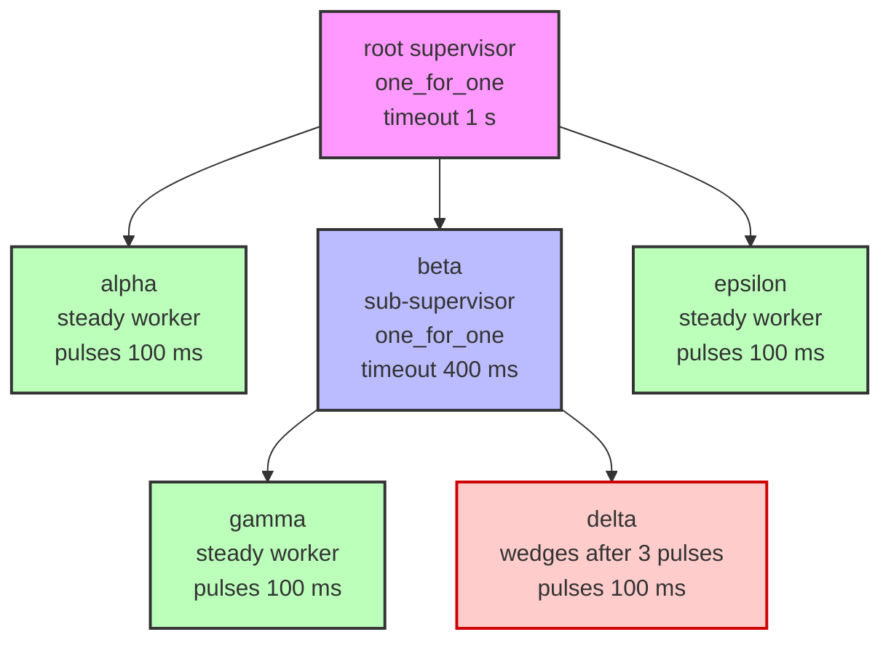

# Tree Supervisor — an Erlang-style supervision tree

This example shows how to supervise **multiple children at once**, where children can
themselves be supervisors — forming a **supervision tree**, the core idea behind
Erlang's `supervisor` behaviour.

Unlike [4/](../4) (stacked stewards, a single vertical chain), a tree supervisor
branches: one supervisor watches several workers and/or sub-supervisors, and each
of those can watch their own children.

```text
root (one_for_one, timeout 1 s)
├─ alpha   steady worker (pulses 100 ms)
├─ beta    sub-supervisor (one_for_one, timeout 400 ms)
│   ├─ gamma  steady worker (pulses 100 ms)
│   └─ delta  wedges after 3 pulses (pulses 100 ms)
└─ epsilon steady worker (pulses 100 ms)
```



## How it works

A `Supervisor` holds a slice of `child`s. Each child is started with its own
cancellable context and heartbeat channel, and pulses on its own interval.
The supervisor's supervision loop ticks every 100 ms and checks each child:

- **Closed heartbeat channel** → the child exited cleanly → unhealthy.
- **No pulse for longer than `timeout`** → the child is wedged or dead → unhealthy.

When one or more children are unhealthy, the restart strategy decides what to
do:

| Strategy | Meaning |
|---|---|
| `one_for_one` | Restart only the child that failed. |
| `one_for_all` | Restart every child if any one fails. |
| `rest_for_all` | Restart the failed child and every child started after it. |

A restarted child is a brand-new goroutine; the wedged one is left to leak (Go
cannot kill a goroutine) but is no longer part of the supervised service.

## Why a tree?

Because `Supervisor` implements `startGoroutineFn` — the same signature as a
plain worker — a supervisor can be registered as a child of another supervisor.
The outer supervisor never knows whether its child is a worker or a whole
subtree. Nesting supervisors this way is what produces the tree:

- `root` watches `alpha`, `beta`, `epsilon`.
- `beta` watches `gamma` and `delta`.

When `delta` wedges after three pulses, `beta` notices the silence (after its
400 ms timeout) and restarts **only delta**. `root` keeps pulsing every 200 ms
the whole time, so `main` sees an uninterrupted heartbeat — the repair is
masked from above, just like stacked stewards.

## Run it

```sh
cd 5
go run .
```

It runs for 6 seconds, then `main` shuts the whole tree down.

## Sample output (abridged)

```
09:50:07 main: starting (goroutines = 1)
09:50:07 root: started child alpha
09:50:07 beta: started child gamma
09:50:07 beta: started child delta
09:50:07 root: started child beta
09:50:07 root: started child epsilon
09:50:07 alpha: running (goroutines = 9)
09:50:07 epsilon: running (goroutines = 9)
09:50:07 delta: running (goroutines = 9)
09:50:07 gamma: running (goroutines = 9)
09:50:07 main: heartbeat from root supervisor
09:50:07 delta: wedged after 3 pulses; no longer pulsing (goroutines = 9)
09:50:08 main: heartbeat from root supervisor
09:50:08 beta: unhealthy children [delta] (strategy one_for_one)
09:50:08 beta: restarted delta (restart #1)
09:50:08 delta: running (goroutines = 10)
09:50:08 main: heartbeat from root supervisor
...
09:50:13 main: halting supervision tree
09:50:13 root: stopped
09:50:13 beta: stopped
09:50:13 main: done (goroutines = 4)
```

## Reading it

- `main` never misses a heartbeat: `root` pulses through the entire `delta`
  outage. The tree heals itself locally.
- Only `delta` is restarted — `alpha`, `beta`, `gamma`, `epsilon` are untouched
  (that is `one_for_one`).
- `delta #1` stays wedged and leaked, but `delta #2` is healthy and takes over
  the service. Goroutine count reflects the leak: wedged goroutines can only be
  reclaimed at process exit.

## Relationship to the other examples

| Directory | Shape | What it heals |
|---|---|---|
| `4/` | Stacked stewards — a vertical chain | A wedged *steward* by the steward above it |
| `5/` | Supervision tree — branching | Multiple children, with restart strategies |

Each directory is a self-contained `go run .` example with its own `go.mod`.

## Solving the leak

The tree heals the *service*, not the *leak*: Go cannot kill a goroutine, so a
wedged `delta #1` and anything it blocked on keep running until the process
exits. There is no `KillGoroutine()` in Go, so the options are:

| Approach | Solves uncooperative wedges? | Cost |
|---|---|---|
| **Cooperative cancellation** (`context.Context`) | No — the worker must check `ctx.Done()` and exit itself | Minimal; idiomatic Go |
| **Process isolation** | **Yes** — kill the OS process, the kernel reclaims everything | Heavy; IPC and serialization |
| **Never wedge** (design discipline) | Prevents the problem entirely | Requires care at every blocking call |
| **Accept and document** | No | None; the wedged goroutine leaks until process exit |

Example 5 uses cooperative cancellation (`context.Context`) so that healthy
workers exit when told, but a truly wedged worker that ignores `ctx.Done()`
still leaks. For true Erlang-style "kill and reclaim everything," you need OS
process boundaries — one worker per process, supervised over IPC — which is far
heavier than goroutines.

## Go conventions

Go's standard library does not include an Erlang-style supervisor. The idiomatic
Go building blocks are:

- **`context.Context`** — cooperative cancellation
- **`golang.org/x/sync/errgroup`** — goroutine groups that cancel on the first error

Many Go projects implement a lightweight steward or supervisor inline rather
than pulling in a dependency, because Go's model leans toward **explicit**
cancellation and error propagation rather than implicit "let it crash"
supervision. Example 5 follows this spirit: it is a small, self-contained
restart loop built on top of `context.Context`.

For production workloads, a common pattern is to combine `context`/`errgroup`
with a small restart loop tailored to your failure model — for example, wrapping
the whole supervision tree in an `errgroup` so that a fatal error at any level
cancels the entire tree cleanly.

## Production note

This is a teaching example, not production code. Use `context.Context` for
cancellation, `golang.org/x/sync/errgroup` for goroutine groups, never
`time.Sleep` to synchronize shutdown, and test failure injection deterministically
rather than relying on timing.
